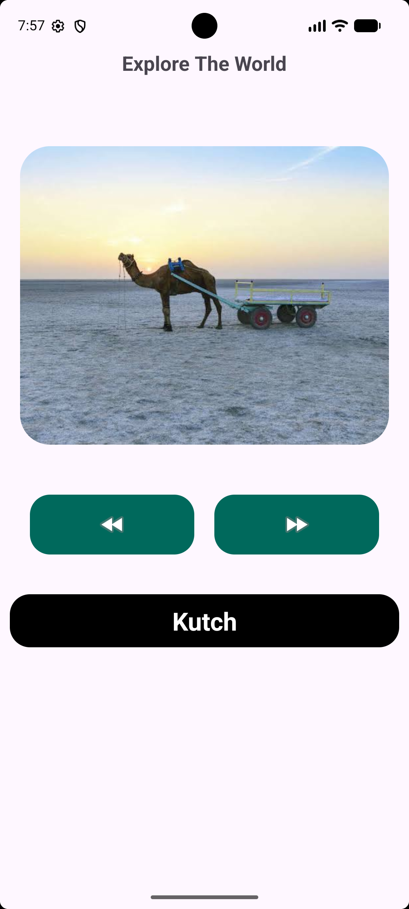
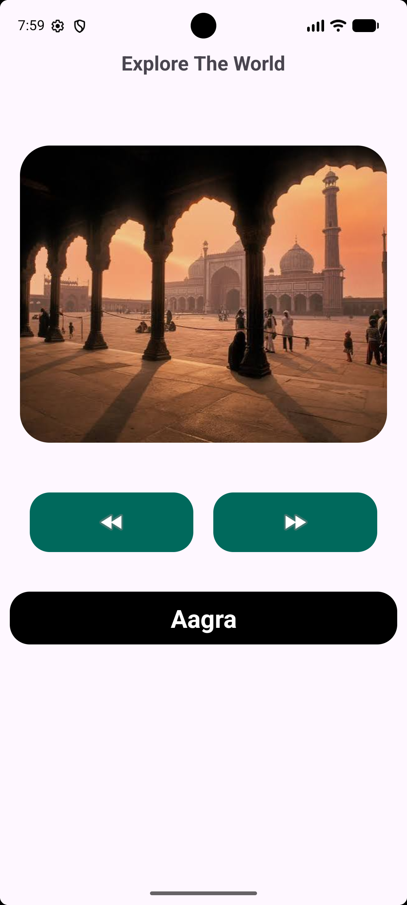
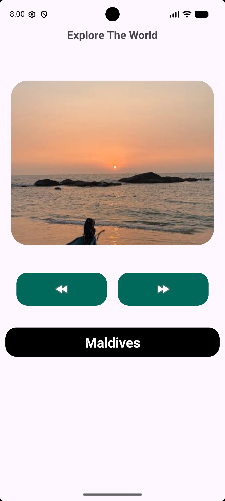

 Explore The World

Discover. Explore. Experience.

"Explore The World" is an Android application developed using Kotlin and XML. It provides an interactive photo gallery where users can explore beautiful tourist destinations through images.

Users can navigate between different destination images using Previous and Next buttons. The destination name automatically updates whenever the displayed image changes.

 Features

- Interactive destination photo gallery
- Previous and Next image navigation
- Dynamic destination name updates
- Attractive and user-friendly interface
- Continuous navigation between images

 Destinations

The application currently includes the following destinations:

- Kutch
- Delhi
- Agra
- Vrindavan
- Banaras
- Maldives

Technologies Used

- Programming Language: Kotlin
- UI Design:XML
- IDE:Android Studio
- Layout: LinearLayout and ConstraintLayout
- UI Components: ImageView, ImageButton, TextView

 Application Screenshots

<!-- Add your application screenshots here -->

You can add your screenshots below:

 Learning Objectives

This project helped me understand:

- Android application development using Kotlin.
- Designing user interfaces using XML.
- Working with ImageView and ImageButton.
- Handling button click events.
- Updating UI elements dynamically.
- Managing images and drawable resources.

 Developer

Supriya Surendra Bhakta

GitHub: [supriya-bhakta](https://github.com/supriya-bhakta)
